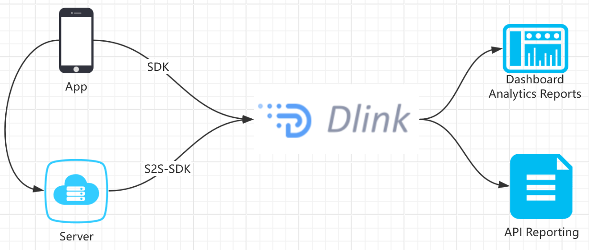

# S2S Event API

This article explains how to send event data from an advertiser's server to Dlink to measure mobile events that occur outside of the app.


###  Server-to-Server (S2S) Event API for Mobile Devices
The Dlink platform attributes and logs mobile app events sent by Dlink SDKs and APIs, allowing you to use the S2S API to report events that occur outside of your application (such as a renewal completed by a user on your website).
### Dlink will populate the following information into S2S events:

  * Values sent in the S2S message
  *  Partial attribution information from Dlink, such as activation time and media source.

For key events (like payments), you can use the Server-to-Server Event API for integration. To send events via API, please ask your developers to complete the relevant setup according to the Server-to-Server Event API.

# Integrating the SDK
Step 1: Obtain `App Code` and `API Token`

Register an account at https://console.dlink.cloud. After creating an app on the platform, obtain the corresponding `App Code` and `API Token` for App Setting.

Step 2: Obtain the SDK

(1) Configure the Maven repository

```xml

    <repositories>
        <repository>
            <id>deeplink</id>
            <name>deeplink</name>
            <url>https://maven.deeplink.dev/repository/maven-releases/</url>
        </repository>
    </repositories>
    
```
(2) Configuring the Maven coordinates of an SDK in `pom.xml`
```xml

<dependency>
  <groupId>dev.deeplink.sdk</groupId>
  <artifactId>server-sdk-java</artifactId>
  <version>2.5.6</version>
</dependency>

```

Step 3: Initialize the SDK

```java
 ApiContext CONTEXT = ApiContext.create("{App Code}", "{API Token}")
            .setApiUrl("https://api.deeplink.dev/");

```

Step 4: Use the SDK

[Tests Example: src/test/java/dev/deeplink/sdk/EventReportTests.java](src/test/java/dev/deeplink/sdk/EventReportTests.java)

```java
    @Test
    @DisplayName("PurchaseEvent — 购买")
    public void testPurchaseEvent() {
        EventReportRequest request = base(EventTypeEnum.PurchaseEvent, "ORD-");
        request.setCustomData(single("sku_001", "TestProduct", 299F, 1L, "USD", 299F));
        execute(request);
    }

    private static EventReportRequest base(EventTypeEnum type, String eventIdPrefix) {
          long now = System.currentTimeMillis();
          EventReportRequest request = new EventReportRequest();
          request.setEventId(eventIdPrefix + now);
          request.setEventTime(now);
          request.setEventType(type.getCode());
          request.setActionSource(ActionSourceEnum.website.getCode());
          request.setDeepLinkId(DEEP_LINK_ID);
          request.setAccessUserId(ACCESS_USER_ID);
          request.setAppData(new EventReportItem.AppData()
              .setOsVersion("10/11")
              .setPlatform("ios")
              .setLocale("en-US")
              .setTimezone("GMT-4:00"));
          return request;
      }
  
      private static EventReportItem.OrderCustom single(
          String productId, String productName, float unitPrice, long qty, String currency, float totalValue
      ) {
          EventReportItem.OrderCustom data = new EventReportItem.OrderCustom();
          data.setCurrency(currency);
          data.setValue(totalValue);
          data.setContents(Collections.singletonList(
              new EventReportItem.OrderCustom.Content()
                  .setProductId(productId)
                  .setProductName(productName)
                  .setQuantity(qty)
                  .setValue(unitPrice)
          ));
          return data;
      }
  
      private static void execute(EventReportRequest request) {
          Result<EventReportResponse> result = CONTEXT.execute(request);
          System.out.println(request.getEventType() + " => " + JSONUtil.toJsonStr(result));
          assertNotNull(result);
          assertTrue(Boolean.TRUE.equals(result.getSuccess()), result.getMessage());
      }
    
    @Test
    public void shortLinkRequest() {
        ShortLinkRequest shortLinkRequest = new ShortLinkRequest();
        shortLinkRequest.setShortLinks(Collections.singletonList("https://click.deeplink.dev/click/1b37d2c909466000?pid=test&key=582a2c96f8394c3dae2a5a3aa7ddd096&c=test&dl_c_id=111&dl_adset=111&dl_adset_id=22&dl_ad=33&dl_ad_id=111&dl_ad_type=images&clickid=1213asdasdas&advertising_id=d015c5eb-1588-4156-97f3-c40a7ff19833&idfa=d015c5eb-1588-4156-97f3-c40a7ff19833"));
        Result<Map<String,String>> result = CONTEXT.execute(shortLinkRequest);
        System.out.println("result: " + JSONUtil.toJsonStr(result) );
    }
```
